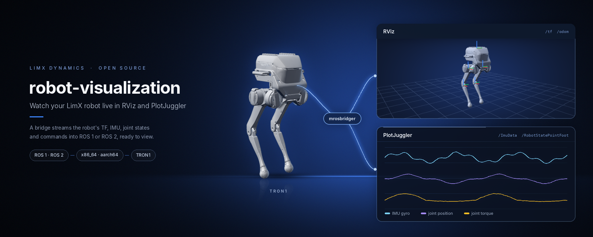
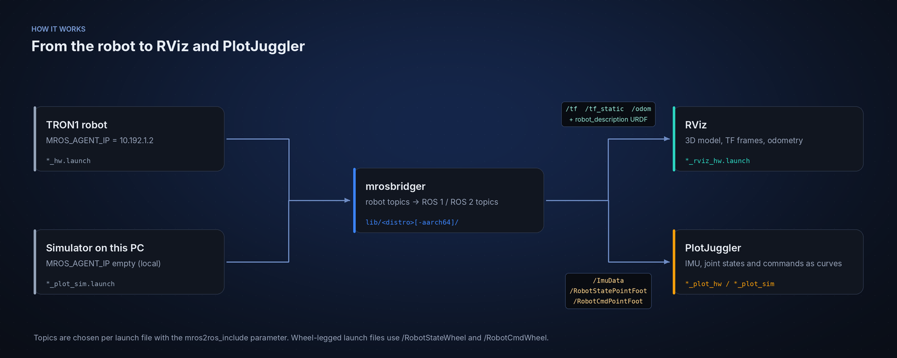

<p align="center">
  
</p>

<p align="center">
  <b>English</b> | <a href="README_cn.md">中文</a>
</p>

<p align="center">
  <a href="LICENSE"></a>
  
  
  
</p>

# robot-visualization

Watch a LimX robot move in RViz and read its joints, IMU and odometry as live
curves in PlotJuggler — without writing a single ROS node. One prebuilt bridging
binary plus ready-made launch, RViz and PlotJuggler configs, for ROS 1 and ROS 2,
against the real robot or a local simulator.

**Scope.** This is a read-only view. It subscribes and displays; it does not
record, replay, or command the robot.

## What you get

- **A 3D view that follows the robot.** RViz loads the URDF and draws the joints
  live; the fixed frame is `base_Link`.
- **Time-series traces.** Joint positions and velocities, IMU data and the
  command stream, plotted against time in PlotJuggler with a layout already
  arranged.
- **One binary, every supported distro.** `mrosbridger` ships prebuilt for five
  ROS distributions and two architectures — no source build of the bridge itself.
- **Hardware and simulator, same commands.** The `*_sim` launches leave the agent
  address empty, which points the bridge at the simulator running on the same
  machine.

## Launch files

Every launch file runs the same bridge and differs only in three things: which
topics cross, which agent it connects to, and which tool it opens.

### ROS 1 (Noetic, Melodic)

| Launch file | Robot | Opens | `MROS_AGENT_IP` | Topics forwarded |
|---|---|:--:|---|---|
| `pointfoot_rviz_hw.launch` | point&#8209;foot | RViz | `10.192.1.2` | `/tf` `/tf_static` `/odom` `/VisualizeStatePointFoot` |
| `pointfoot_plot_hw.launch` | point&#8209;foot | PlotJuggler | `10.192.1.2` | `/ImuData` `/RobotCmdPointFoot` `/RobotStatePointFoot` |
| `pointfoot_plot_sim.launch` | point&#8209;foot | PlotJuggler | *(empty)* | `/ImuData` `/RobotCmdPointFoot` `/RobotStatePointFoot` |
| `wheellegged_rviz_hw.launch` | wheel&#8209;legged | RViz | `10.192.1.2` | `/tf` `/tf_static` `/odom` |
| `wheellegged_plot_hw.launch` | wheel&#8209;legged | PlotJuggler | `10.192.1.2` | `/ImuData` `/RobotCmdWheel` `/RobotStateWheel` |
| `wheellegged_plot_sim.launch` | wheel&#8209;legged | PlotJuggler | *(empty)* | `/ImuData` `/RobotCmdWheel` `/RobotStateWheel` |
| `rosbridger.launch` | — | bridge only | `10.192.1.2` | `/tf` `/tf_static` `/odom` |

The two `*_plot_*` point-foot launches load `layout/pointfoot.xml` into
PlotJuggler; the wheel-legged pair loads `layout/wheellegged.xml`.

### ROS 2 (Foxy, Humble, Jazzy)

| Launch file | Robot | Opens | `MROS_AGENT_IP` | Topics forwarded |
|---|---|:--:|---|---|
| `pointfoot_rviz_hw.launch.py` | point&#8209;foot | RViz 2 + `robot_state_publisher` | `10.192.1.2` | `/tf` `/tf_static` `/odom` |
| `pointfoot_plot_hw.launch.py` | point&#8209;foot | PlotJuggler | `10.192.1.2` | `/ImuData` `/RobotCmdPointFoot` `/RobotStatePointFoot` |
| `pointfoot_plot_sim.launch.py` | point&#8209;foot | PlotJuggler | *(unset)* | `/ImuData` `/RobotCmdPointFoot` `/RobotStatePointFoot` |
| `rosbridger.launch.py` | — | bridge only | `10.192.1.2` | `/tf` `/tf_static` `/odom` |

ROS 2 currently ships point-foot only: there is no wheel-legged launch, no
wheel-legged RViz config, and no PlotJuggler layout (the ROS 2 window opens
empty and you pick the curves yourself).

> "pointfoot" means the TRON1 models under `pointfoot/` in `robot_description` —
> PF, SF and WF all live there (`PF_TRON1A`, `SF_TRON1A`, `WF_TRON1A`, …);
> "wheellegged" means the models under `wheellegged/` (`WL_P311D`, `WL_P311E`).

## How the data flows

<p align="center">
  
</p>

The bridge forwards only what `mros2ros_include` lists. That is why it stays
cheap — and why adding a sensor means editing that list rather than writing code.

## Quick start

Nothing here can run before a ROS core exists, so the only real prerequisite is
a working ROS 1 or ROS 2 installation. After that it is four commands:

```bash
cd <workspace>/src
git clone https://github.com/limxdynamics/robot-visualization.git
git clone https://github.com/limxdynamics/tron1-robot-description.git   # provides the robot_description package
cd .. && catkin_make            # ROS 1 (use colcon build for ROS 2)

source devel/setup.bash
export ROBOT_TYPE=PF_TRON1A     # the launch files read this
roslaunch robot_visualization pointfoot_rviz_hw.launch
```

For the simulator instead of hardware, use a `*_sim` launch and start your
simulator with an empty agent address.

## Requirements

- ROS 1 Noetic / Melodic, **or** ROS 2 Foxy / Humble / Jazzy. Any other
  distribution stops the build with `Unknown ROS distribution` — the bridge is a
  prebuilt binary and only those five exist.
- x86_64 or aarch64. `CMakeLists.txt` picks `lib/<distro>/` or
  `lib/<distro>-aarch64/` from `$ROS_DISTRO` and the host architecture.
- `robot_description` in the same workspace: the RViz launches put
  `pointfoot/<ROBOT_TYPE>/urdf/robot.urdf` on the `robot_description` parameter,
  and ROS 2 runs it through `xacro`.
- RViz (part of the ROS desktop install) and, for the plot launches, PlotJuggler.

| | x86_64 | aarch64 |
|---|:--:|:--:|
| ROS 1 Noetic | `lib/noetic` | `lib/noetic-aarch64` |
| ROS 1 Melodic | `lib/melodic` | `lib/melodic-aarch64` |
| ROS 2 Foxy | `lib/foxy` | `lib/foxy-aarch64` |
| ROS 2 Humble | `lib/humble` | `lib/humble-aarch64` |
| ROS 2 Jazzy | `lib/jazzy` | `lib/jazzy-aarch64` |

The ROS 2 trees are complete runtime installs, so `colcon build` copies the
selected one into the workspace root; that is what makes the build look heavy.

**Clone with Git LFS.** The Jazzy bridge binaries are stored through LFS
(`.gitattributes`). Without `git lfs install`, a clone leaves 134-byte pointer
files and the bridge will not start.

## Configuration

| Setting | Where | What it does |
|---|---|---|
| `ROBOT_TYPE` | environment | Selects the URDF the RViz launches load (`PF_TRON1A`, `SF_TRON1A`, `WF_TRON1A`, …). Unset, the launch exits immediately. |
| `MROS_AGENT_IP` | `<env>` in the launch file (ROS 1) / `os.environ` (ROS 2) | Agent address. Empty means the local simulator. **Edit this before running against hardware.** |
| `bridge_mros2ros` | launch parameter | `1` / `true` enables agent-to-ROS forwarding. |
| `mros2ros_include` | launch parameter | Semicolon-separated topic allowlist. Nothing outside this list crosses the bridge. |

## Directory structure

```
.
|-- lib/              # Prebuilt bridge binaries and ROS 2 runtime trees, per distro and arch
|-- ros1/
|   |-- launch/       # 7 launch files: point-foot and wheel-legged, RViz and PlotJuggler
|   |-- layout/       # PlotJuggler layouts (pointfoot.xml, wheellegged.xml)
|   `-- rviz/         # RViz configs (pointfoot.rviz, wheellegged.rviz)
|-- ros2/
|   |-- launch/       # 4 launch.py files: point-foot only
|   `-- rviz/         # RViz config (pointfoot.rviz)
|-- CMakeLists.txt    # Picks lib/<distro>[-aarch64] and installs it
|-- package.xml       # ROS package manifest (package name: robot_visualization)
`-- doc/              # Images used by this README
```

## Troubleshooting

- **`Unknown ROS distribution` at build time.** Your `$ROS_DISTRO` is not one of
  the five supported ones, or `$ROS_DISTRO` is unset.
- **The launch exits with `Please set the ROBOT_TYPE`.** Export `ROBOT_TYPE`
  before `roslaunch` / `ros2 launch`.
- **`mrosbridger: cannot execute binary file` or the process dies immediately.**
  The clone was made without Git LFS, so the binary is a pointer file.
- **RViz opens but no robot appears.** `robot_description` is missing from the
  workspace, or `ROBOT_TYPE` points at a model that does not exist under
  `pointfoot/`.
- **Nothing connects.** Every hardware launch defaults to
  `MROS_AGENT_IP=10.192.1.2`, the address the SDK uses in its own examples. If the
  robot sits on another subnet, edit the `<env>` line in the launch file.
- **ROS 2 PlotJuggler window is empty.** No layout ships for ROS 2; drag the
  topics in manually.

## Related repositories

| Repository | Description |
|---|---|
| [tron1-robot-description](https://github.com/limxdynamics/tron1-robot-description) | URDF / Xacro / MJCF models — provides the `robot_description` package used here |
| [tron1-rl-deploy-ros](https://github.com/limxdynamics/tron1-rl-deploy-ros) | TRON1 RL deployment (ROS) |
| [tron1-rl-deploy-ros2](https://github.com/limxdynamics/tron1-rl-deploy-ros2) | TRON1 RL deployment (ROS 2) |
| [humanoid-rl-deploy-ros](https://github.com/limxdynamics/humanoid-rl-deploy-ros) | Humanoid RL deployment (ROS) |
| [humanoid-rl-deploy-ros2](https://github.com/limxdynamics/humanoid-rl-deploy-ros2) | Humanoid RL deployment (ROS 2) |
| [tron1-mujoco-sim](https://github.com/limxdynamics/tron1-mujoco-sim) | MuJoCo simulator with the same `limxsdk` interface as the robot |

The full map of TRON1 repositories is kept in the
[TRON1 open-source ecosystem](https://github.com/limxdynamics/tron1-rl-isaacgym#tron1-open-source-ecosystem)
section of tron1-rl-isaacgym.

## License

[Apache License 2.0](LICENSE).

The `lib/` directory redistributes prebuilt binaries, including a complete ROS 2
runtime tree under `lib/foxy-aarch64/`. Those packages keep their own licenses;
see [NOTICE](NOTICE) and the `LICENSE` files inside each package directory.

Security reports and contribution guidelines are handled at the organisation
level: [SECURITY.md](https://github.com/limxdynamics/.github/blob/main/SECURITY.md),
[CONTRIBUTING.md](https://github.com/limxdynamics/.github/blob/main/CONTRIBUTING.md).
