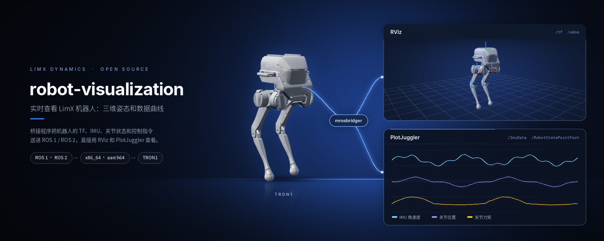
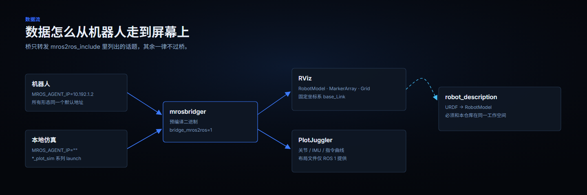

<p align="center">
  
</p>

<p align="center">
  <a href="README.md">English</a> | <b>中文</b>
</p>

<p align="center">
  <a href="LICENSE"></a>
  
  
  
</p>

# robot-visualization

在 RViz 里看 LimX 机器人动起来，在 PlotJuggler 里把关节、IMU、里程计读成实时曲线——
不用写一行 ROS 节点代码。一个预编译的桥接二进制，加一整套现成的 launch、RViz 与
PlotJuggler 配置，支持 ROS 1 / ROS 2，真机与本地仿真都能用。

**适用范围。** 这是只读的可视化：它订阅并显示，不录制、不回放、不下发指令。

## 你能得到什么

- **跟着机器人动的三维视图。** RViz 加载 URDF 并实时绘制各关节，固定坐标系为 `base_Link`。
- **时间序列曲线。** 关节位置与速度、IMU 数据、指令流按时间画在 PlotJuggler 里，布局已排好。
- **一个二进制，覆盖所有支持的发行版。** `mrosbridger` 预编译了五个 ROS 发行版 × 两种架构，
  桥本身不需要编译。
- **真机与仿真用同一套命令。** `*_sim` 系列把 agent 地址留空，桥就指向本机正在跑的仿真器。

## launch 文件

每个 launch 跑的都是同一个桥，区别只有三件事：转发哪些话题、连哪台 agent、打开哪个工具。

### ROS 1（Noetic、Melodic）

| launch 文件 | 机器人 | 打开 | `MROS_AGENT_IP` | 转发的话题 |
|---|---|:--:|---|---|
| `pointfoot_rviz_hw.launch` | 点足 | RViz | `10.192.1.2` | `/tf` `/tf_static` `/odom` `/VisualizeStatePointFoot` |
| `pointfoot_plot_hw.launch` | 点足 | PlotJuggler | `10.192.1.2` | `/ImuData` `/RobotCmdPointFoot` `/RobotStatePointFoot` |
| `pointfoot_plot_sim.launch` | 点足 | PlotJuggler | *（空）* | `/ImuData` `/RobotCmdPointFoot` `/RobotStatePointFoot` |
| `wheellegged_rviz_hw.launch` | 轮足 | RViz | `10.192.1.2` | `/tf` `/tf_static` `/odom` |
| `wheellegged_plot_hw.launch` | 轮足 | PlotJuggler | `10.192.1.2` | `/ImuData` `/RobotCmdWheel` `/RobotStateWheel` |
| `wheellegged_plot_sim.launch` | 轮足 | PlotJuggler | *（空）* | `/ImuData` `/RobotCmdWheel` `/RobotStateWheel` |
| `rosbridger.launch` | — | 仅启动桥 | `10.192.1.2` | `/tf` `/tf_static` `/odom` |

两个点足 `*_plot_*` 会把 `layout/pointfoot.xml` 载入 PlotJuggler，轮足那一对载入
`layout/wheellegged.xml`。

### ROS 2（Foxy、Humble、Jazzy）

| launch 文件 | 机器人 | 打开 | `MROS_AGENT_IP` | 转发的话题 |
|---|---|:--:|---|---|
| `pointfoot_rviz_hw.launch.py` | 点足 | RViz 2 + `robot_state_publisher` | `10.192.1.2` | `/tf` `/tf_static` `/odom` |
| `pointfoot_plot_hw.launch.py` | 点足 | PlotJuggler | `10.192.1.2` | `/ImuData` `/RobotCmdPointFoot` `/RobotStatePointFoot` |
| `pointfoot_plot_sim.launch.py` | 点足 | PlotJuggler | *（未设置）* | `/ImuData` `/RobotCmdPointFoot` `/RobotStatePointFoot` |
| `rosbridger.launch.py` | — | 仅启动桥 | `10.192.1.2` | `/tf` `/tf_static` `/odom` |

ROS 2 目前只有点足：没有轮足的 launch、没有轮足的 RViz 配置，也没有 PlotJuggler 布局
（ROS 2 下窗口是空的，曲线要自己拖）。

> 这里的 "pointfoot" 指 SF（足板）系列，"wheellegged" 指 WF（轮足）系列——文件名沿用了
> 本仓库既有 launch 的命名。

## 数据怎么流动

<p align="center">
  
</p>

桥只转发 `mros2ros_include` 里列出的话题。这是它开销小的原因，也是加传感器时要去改参数、
而不是改代码的原因。

## 快速开始

在 ROS 环境装好之前，这里什么也跑不起来，所以唯一真正的前置条件是一个可用的 ROS 1 或
ROS 2。装好之后就是四条命令：

```bash
cd <workspace>/src
git clone https://github.com/limxdynamics/robot-visualization.git
git clone https://github.com/limxdynamics/tron1-robot-description.git   # 提供 robot_description 包
cd .. && catkin_make            # ROS 1（ROS 2 用 colcon build）

source devel/setup.bash
export ROBOT_TYPE=PF_TRON1A     # launch 文件会读这个变量
roslaunch robot_visualization pointfoot_rviz_hw.launch
```

想连仿真而不是真机，用 `*_sim` 系列 launch，并让仿真器的 agent 地址保持为空。

## 环境要求

- ROS 1 Noetic / Melodic，**或** ROS 2 Foxy / Humble / Jazzy。其它发行版会在编译阶段直接
  报 `Unknown ROS distribution`——桥是预编译二进制，只有这五种。
- x86_64 或 aarch64。`CMakeLists.txt` 按 `$ROS_DISTRO` 和宿主架构选择 `lib/<distro>/`
  或 `lib/<distro>-aarch64/`。
- 同一个工作空间里要有 `robot_description`：RViz 的 launch 会把
  `pointfoot/<ROBOT_TYPE>/urdf/robot.urdf` 塞进 `robot_description` 参数，ROS 2 下还会
  走一遍 `xacro`。
- RViz（ROS desktop 安装自带）；画曲线的 launch 还需要 PlotJuggler。

| | x86_64 | aarch64 |
|---|:--:|:--:|
| ROS 1 Noetic | `lib/noetic` | `lib/noetic-aarch64` |
| ROS 1 Melodic | `lib/melodic` | `lib/melodic-aarch64` |
| ROS 2 Foxy | `lib/foxy` | `lib/foxy-aarch64` |
| ROS 2 Humble | `lib/humble` | `lib/humble-aarch64` |
| ROS 2 Jazzy | `lib/jazzy` | `lib/jazzy-aarch64` |

ROS 2 那几套是完整的运行时安装，`colcon build` 会把选中的那套拷到工作空间根目录，
所以编译看起来体量很大。

**必须带 Git LFS 克隆。** Jazzy 的桥二进制走 LFS（见 `.gitattributes`）。没装
`git lfs` 的话，克隆下来是 134 字节的指针文件，桥起不来。

## 配置项

| 配置 | 位置 | 作用 |
|---|---|---|
| `ROBOT_TYPE` | 环境变量 | 决定 RViz 加载哪个 URDF（`PF_TRON1A`、`SF_TRON1A`、`WF_TRON1A` 等）。未设置时 launch 直接退出。 |
| `MROS_AGENT_IP` | launch 的 `<env>`（ROS 1）/ `os.environ`（ROS 2） | agent 地址。留空表示连本机仿真器。**连真机前必须改这里。** |
| `bridge_mros2ros` | launch 参数 | `1` / `true` 打开 agent→ROS 的转发。 |
| `mros2ros_include` | launch 参数 | 分号分隔的话题白名单，列表之外一律不过桥。 |

## 目录结构

```
.
|-- lib/              # 预编译桥二进制与 ROS 2 运行时，按发行版和架构分目录
|-- ros1/
|   |-- launch/       # 7 个 launch：点足与轮足，RViz 与 PlotJuggler
|   |-- layout/       # PlotJuggler 布局（pointfoot.xml、wheellegged.xml）
|   `-- rviz/         # RViz 配置（pointfoot.rviz、wheellegged.rviz）
|-- ros2/
|   |-- launch/       # 4 个 launch.py：只有点足
|   `-- rviz/         # RViz 配置（pointfoot.rviz）
|-- CMakeLists.txt    # 选择并安装 lib/<distro>[-aarch64]
|-- package.xml       # ROS 包清单（包名：robot_visualization）
`-- doc/              # 本 README 用到的图片
```

## 常见问题

- **编译时报 `Unknown ROS distribution`。** `$ROS_DISTRO` 不在支持的五个之内，或者根本没设。
- **launch 报 `Please set the ROBOT_TYPE` 后退出。** 在 `roslaunch` / `ros2 launch` 之前先
  `export ROBOT_TYPE`。
- **`mrosbridger: cannot execute binary file`，或进程起来就退。** 克隆时没走 Git LFS，
  拿到的是指针文件。
- **RViz 打开了但看不到机器人。** 工作空间缺 `robot_description` 包，或 `ROBOT_TYPE`
  指向了 `pointfoot/` 下不存在的模型。
- **连不上。** 所有连真机的 launch 默认都是 `MROS_AGENT_IP=10.192.1.2`，这也是 SDK 示例里
  用的地址。机器人不在这个网段时，改 launch 里的 `<env>` 那一行。
- **ROS 2 的 PlotJuggler 窗口是空的。** ROS 2 没有附带布局文件，需要手动把话题拖进窗口。

## 相关仓库

| 仓库 | 描述 |
|---|---|
| [tron1-robot-description](https://github.com/limxdynamics/tron1-robot-description) | URDF / Xacro / MJCF 模型——本仓库用到的 `robot_description` 包由它提供 |
| [tron1-rl-deploy-ros](https://github.com/limxdynamics/tron1-rl-deploy-ros) | TRON1 RL 部署（ROS） |
| [tron1-rl-deploy-ros2](https://github.com/limxdynamics/tron1-rl-deploy-ros2) | TRON1 RL 部署（ROS 2） |
| [humanoid-rl-deploy-ros](https://github.com/limxdynamics/humanoid-rl-deploy-ros) | Humanoid RL 部署（ROS） |
| [humanoid-rl-deploy-ros2](https://github.com/limxdynamics/humanoid-rl-deploy-ros2) | Humanoid RL 部署（ROS 2） |
| [tron1-mujoco-sim](https://github.com/limxdynamics/tron1-mujoco-sim) | MuJoCo 仿真器，接口与真机一致（`limxsdk`） |

TRON1 全部仓库与上手路线整理在 tron1-rl-isaacgym 的
[TRON1 开源生态](https://github.com/limxdynamics/tron1-rl-isaacgym/blob/master/README_cn.md#tron1-开源生态)
一节。

## 许可证

[Apache License 2.0](LICENSE)。

`lib/` 目录分发了预编译二进制，其中 `lib/foxy-aarch64/` 是一整套 ROS 2 运行时。这些包各自
保留自己的许可证，详见 [NOTICE](NOTICE) 以及各包目录内的 `LICENSE` 文件。

安全报告与贡献指南由组织统一维护：
[SECURITY.md](https://github.com/limxdynamics/.github/blob/main/SECURITY.md)、
[CONTRIBUTING.md](https://github.com/limxdynamics/.github/blob/main/CONTRIBUTING.md)。
